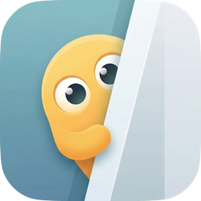
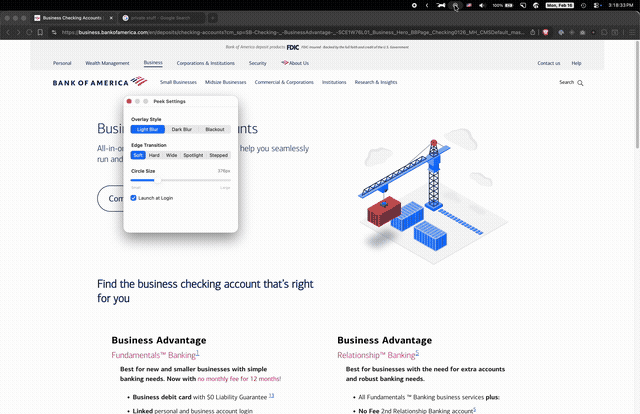

<h1>Peek</h1>

A digital privacy screen for macOS. 
It blurs everything except a clear circle around your cursor.

<strong>Version 1.2</strong> · macOS 13+ · Apple Silicon & Intel

  
  
  

<a href="https://apps.apple.com/us/app/peek-screen-privacy/id6800797352?mt=12">Download Peek on the Mac App Store</a>

Peek is a menu bar app for working in coffee shops, trains or anywhere someone sits next to you.

- Only the area around your cursor stays readable.
- Clicks pass straight through to whatever is underneath.
- Toggle it with `⌥⌘P`, or a shortcut you pick.

## How it works

Turn Peek on from the menu bar icon or the shortcut. Choose Light Blur, Dark Blur or Blackout, and a circle size from 100 to 1200 px; the circle follows your cursor with no lag. Settings opens with `Cmd ,`.

## Privacy

Peek collects and sends nothing, and it doesn't need Accessibility, Input Monitoring or Screen Recording permission. See the [privacy policy](PRIVACY.md).

## Limits

Peek is for nearby eyes, not a security control. How screenshots, recordings, screen sharing, AirPlay and Sidecar see it varies by macOS version and capture method, so don't rely on it alone for sensitive information.

## Install

Get it on the [Mac App Store](https://apps.apple.com/us/app/peek-screen-privacy/id6800797352?mt=12). To build it, you need Swift 5.9 and macOS 13: `./build-app.sh` builds, signs and packages `Peek.dmg`, and the Xcode project comes from `project.yml` with XcodeGen. Help is in [SUPPORT.md](SUPPORT.md).

---

[MIT](LICENSE)

Made by [santiagoalonso.com](https://santiagoalonso.com)
